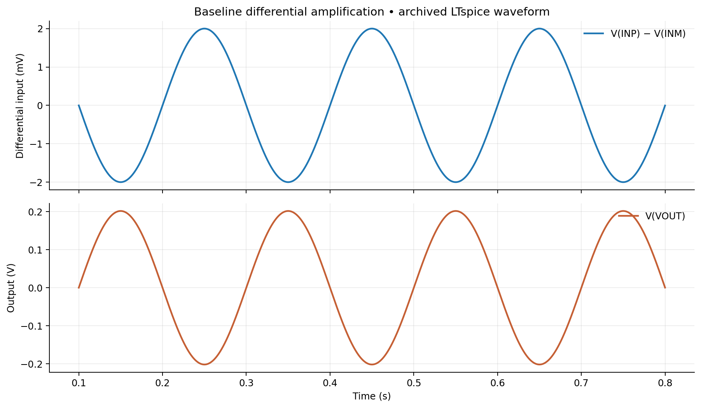
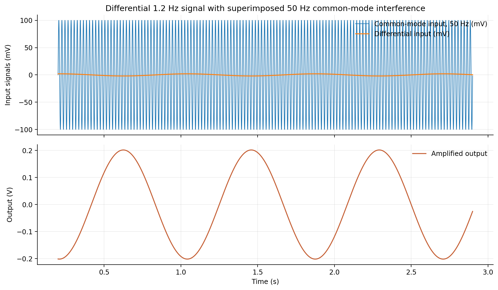
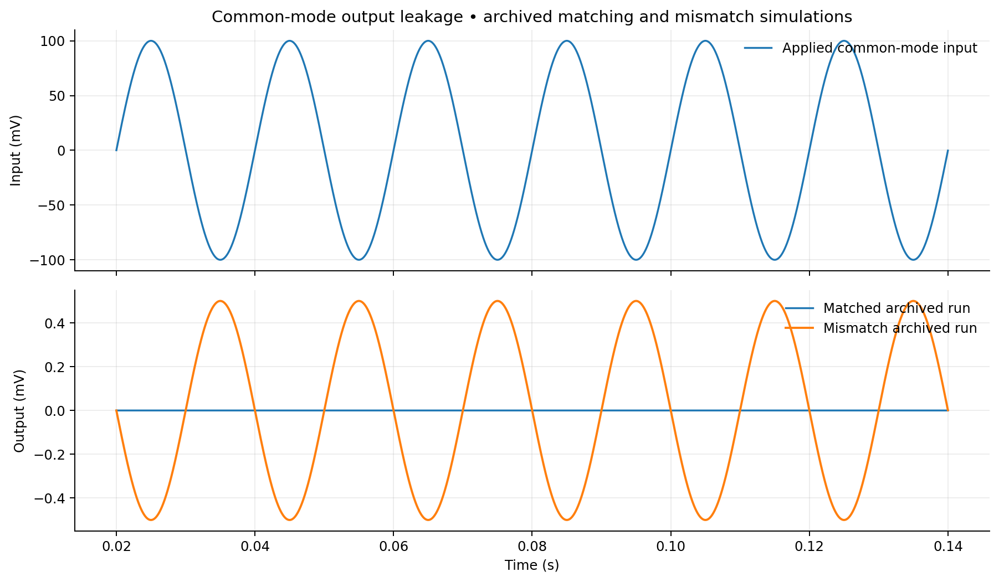
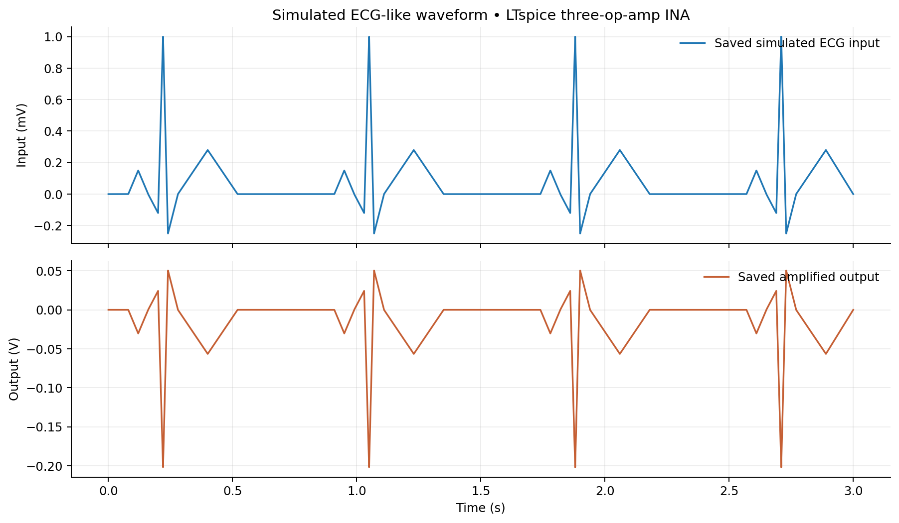

# Three-Op-Amp Instrumentation Amplifier | LTspice Characterization

**Precision differential amplification · 50 Hz common-mode interference · resistor matching · ECG-like signal simulation**



This is a reproducible *educational circuit study* of a classical **three-op-amp instrumentation amplifier (INA)**, built and investigated in **LTspice 26.0.2 for macOS**. It compares ideal resistor-ratio predictions with actual simulation measurements and explores why common-mode rejection depends on the resistor network. The op-amps use LTspice's **UniversalOpAmp2** macro-model; this is **not** a transistor-level custom CMOS INA, measured PCB, fabricated IC, or medical device.

## Results at a glance

| Metric | Recorded value | Evidence |
|---|---:|---|
| Nominal differential voltage gain | **101 V/V** | Resistor-ratio calculation |
| Measured differential gain magnitude | **100.9896 V/V** | [LTspice log](evidence/01_baseline_gain.txt) |
| Gain deviation from nominal | **~0.0103%** | Calculation |
| Differential input | **4.000 mV p-p** | [LTspice log](evidence/01_baseline_gain.txt) |
| Amplifier output | **403.958 mV p-p** | [LTspice log](evidence/01_baseline_gain.txt) |
| Archived common-mode gain (mismatch run) | **0.005000 V/V** | [LTspice log](evidence/03_mismatch_cmrr.txt) |
| Archived mismatch CMRR | **86.106 dB** | [LTspice log](evidence/03_mismatch_cmrr.txt), using \(A_d=100.989\) |

> **Important traceability note:** The archived mismatch `.raw` and `.log` show common-mode leakage, but the archived `.asc` named `1percent_mismatch` currently saves **equal-valued 10 kΩ resistors**. Consequently the exact archived 86.106 dB result cannot be reproduced from that saved schematic alone. A *newly prepared, clearly labeled* 1%-resistor-change example is provided; **its result has not been re-simulated or substituted for the archived one**. See [reproducibility notes](notes/reproducibility.md).

## 1. Circuit topology and analytical gain

The first stage uses two non-inverting input op-amps with 10 kΩ feedback resistors and a **200 Ω gain-setting resistor**. The second stage is a resistor-matched difference amplifier with nominal 10 kΩ resistor network. Supply rails are **±12 V**.

For the ideal three-op-amp INA with matched second-stage ratios:

\[
A_{d} = \left(1 + \frac{2R}{R_G}\right)\frac{R_f}{R_{in}}
= \left(1 + \frac{2\cdot10,000}{200}\right)\frac{10,000}{10,000}
= 101\ \mathrm{V/V}
\]

Simulation gives **100.9896 V/V magnitude**, about **0.0103%** below the nominal ideal gain. Refer to the [analysis](notes/analysis.md) for assumptions, limitations and numeric calculations.

**Open the baseline LTspice circuit:** [`circuits/01_Baseline_Gain.asc`](circuits/01_Baseline_Gain.asc)

### Original LTspice schematic and screenshots

You can put your authentic LTspice screenshots in [`evidence/`](evidence/README.md). Screenshots are supporting evidence; the runnable `.asc` circuits remain the source of truth. Do not replace the plots with unsourced mockups.

## 2. Differential gain verification


From the archived `.meas` values:

\[
\left|A_d\right|=\frac{V_{out,pp}}{V_{diff,pp}} = \frac{0.403958141804}{0.00399999786168}=100.989589\ \mathrm{V/V}.
\]

*Figure generated directly from the supplied LTspice binary waveform. This is post-processing of real simulation output, not an oscilloscope screenshot.*

## 3. 50 Hz common-mode interference



A 1.2 Hz low-amplitude differential test waveform is superimposed on a much larger **50 Hz, 100 mV peak common-mode** signal. In the archived practical run, the differential gain remains approximately **100.9895 V/V**. This illustrates rejection of a shared interfering signal in the matched model.

**Circuit:** [`circuits/02_Mixed_Signal_50Hz.asc`](circuits/02_Mixed_Signal_50Hz.asc). The waveform shown comes from the **archived practical run**; its saved schematic was not identical to that run. See the [provenance and reproducibility notes](notes/reproducibility.md).

## 4. Resistor matching and CMRR



The archived common-mode test output is near zero for an ideally matched resistor network. The archived mismatch run exhibits approximately **1.000 mV p-p** output from **200 mV p-p** common-mode input:

\[
|A_{cm}|\approx 0.00100000657 / 0.1999999583=0.00500003.
\]

\[
\mathrm{CMRR_{dB}}=20\log_{10}\left|\frac{A_d}{A_{cm}}\right|=86.106\ \mathrm{dB}.
\]

**Runnable study circuits:** [matched](circuits/03_Common_Mode_Matched.asc) · [new 1%-mismatch example](circuits/04_Common_Mode_1pct_Example.asc). Their simulations must be run to establish their own measured values; do not assume they exactly reproduce the archive.

## 5. ECG-like waveform illustration (simulation only)



An illustrative ECG-like waveform was combined with a 50 Hz common-mode sine source in the saved LTspice demonstration. The **saved input and output traces** are presented here. This exercise demonstrates circuit-level signal behaviour, **not validated patient data, medical-grade signal quality or clinical ECG measurement**.

The original `.asc` referred to a missing absolute-path PWL file. To make the demonstration more portable, [`data/ecg_reconstructed_from_raw.txt`](data/ecg_reconstructed_from_raw.txt) contains an **explicitly labeled reconstruction from the archived `V(ecg)` waveform**, sampled every 1 ms. It is *not* the originally generated source file.

**Circuit:** [`circuits/05_ECG_Demonstration.asc`](circuits/05_ECG_Demonstration.asc) — uses a relative PWL path that may need adjustment based on how LTspice resolves local files.

## Repository map

```text
circuits/        Five clearly named LTspice simulations and test cases
figures/         Four plots derived from supplied LTspice RAW data
results/         Logged results in CSV form
notes/           Analytical derivations and reproducibility caveats
data/            Reconstructed ECG-like stimulus (not original PWL)
evidence/        Redacted log excerpts, original saved .asc files
```

## Reproduce and verify

1. Clone/download the repository, open `circuits/01_Baseline_Gain.asc` in LTspice and run it.
2. Inspect the output and differential input signals `V(VOUT)` and `V(INP,INM)`.
3. Open **View → SPICE Error Log** for `.meas` outputs; compare with [`results/measurements.csv`](results/measurements.csv).
4. Open `03_Common_Mode_Matched.asc` and `04_Common_Mode_1pct_Example.asc` to compare common-mode output, then calculate your own CMRR. The archived mismatch value is listed separately, not asserted as the result of the new example.
5. For the optional ECG-like demonstration, verify that LTspice can locate the relative PWL text file.

## Limitations and next steps

- Uses a built-in macro-model rather than transistor-level CMOS op-amp design.
- All results are **simulation-based**, with no measured PCB or fabricated-chip data.
- Original experiment filenames and saved schematics do not consistently match the archived run settings; see [notes](notes/reproducibility.md).
- Future work: resistor tolerance Monte Carlo sweeps, CMRR-versus-frequency, input offset, noise, bandwidth and a transistor-level INA implementation.

**Tools:** LTspice · analog circuit theory · differential signalling · common-mode rejection · waveform analysis
